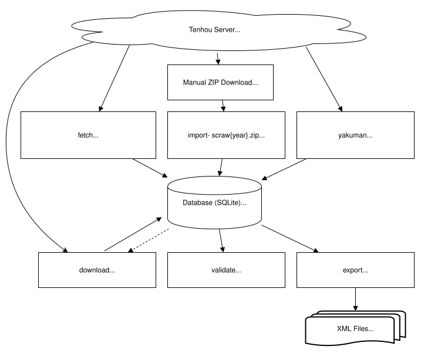

# houou-logs

Tools to download Houou (Phoenix) logs from tenhou.net

> [!CAUTION]
> Tenhou prohibits redistribution of game logs. Do not publish, share, mirror, or redistribute downloaded log data.
>
> Source:
>
> - <https://x.com/i/status/2052271028982931548>

> [!WARNING]
> Tenhou allows only **one session** to download logs at a time.  
> Running multiple instances (e.g., via multiple terminals or background processes) **violates Tenhou's terms of use** and may result in access restrictions or bans.
>
> This tool is designed to operate with a **single session only**, in accordance with Tenhou's policy.  
> While it does not prevent concurrent execution at the system level,  
> **do not attempt to run multiple sessions simultaneously.**
>
> References:
>
> - <https://tenhou.net/sc/raw/>
> - <https://x.com/tsuno_s/status/1804487739657580636>

## Implementation concept diagram



## Installation

```sh
# With pip.
houou-logs$ pip install .
# With uv.
houou-logs$ uv tool install .
```

## Usage

> [!NOTE]
> Databases created with houou-logs **2.1.2 or earlier** are migrated
> automatically the first time any command is run with this version.
> Missing log indexes are added while existing indexes and log data are
> preserved. No reimport is needed.
>
> Creating indexes requires additional disk space and may take some time.

### Import log IDs from an archive (per year)

Import a list of log IDs into the database.

Each list file inside the ZIP archive is committed after it has been fully
read and inserted. If a file fails, its pending changes are rolled back and
the command stops; previously completed files remain saved. You can rerun
the same archive: existing log IDs are ignored. Invalid IDs are reported and
skipped. Import does not update the FileIndex used by `fetch`.

> [!NOTE]
>
> - Houou (Phoenix) games are available starting from 2009.
> - Fetching yearly archive files from `https://tenhou.net/sc/raw/scrawYYYY.zip` currently returns 404.
>   The `import` command is still available for archive files that have already been obtained.

```sh
houou-logs import <db-path> <archive-path>
```

Example:

Import log IDs for the year 2009.

1. Download the archive file manually: `https://tenhou.net/sc/raw/scraw2009.zip`
2. Place the file in the current working directory.
3. Run:

    ```sh
    houou-logs import db/2009.db scraw2009.zip
    ```

### Fetch latest log IDs

Fetch a list of log IDs into the database.

This command uses Tenhou's FileIndex sizes to skip log files that are already fetched and unchanged.

It also follows Tenhou's 20-minute minimum update interval.
The default mode and archive mode track their last FileIndex attempt times separately.
If the same mode is executed again within 20 minutes, the command exits without fetching the FileIndex.

A failed FileIndex request is still recorded as an attempt, so repeated automated runs do not immediately retry against Tenhou.

List file request failures are handled as follows:

- HTTP 408, 429, 5xx, or network errors stop fetching without automatic retries.
- Other HTTP errors (such as 404) and invalid list file contents are reported per file, and processing continues.

Any `Retry-After` header is displayed as supplied (seconds or an HTTP date); use it as a guide for when to retry.

Successfully imported files remain committed. Failed or unprocessed files remain eligible for a later run, subject to the same 20-minute interval.

The final summary reports inserted IDs and successful and failed list files.
Partial failure, complete failure, or stopping due to a temporary error returns
exit code 1. Unprocessed files are excluded from both file counts.
Unchanged files, a valid empty index or list, lists containing only existing IDs,
and skips within the 20-minute interval return exit code 0.

#### Fetch log IDs from the latest 7 days (default mode)

```sh
houou-logs fetch <db-path>
```

Example:

```sh
houou-logs fetch db/current-year.db
```

#### Fetch log IDs from January 1 of the current year until 7 days before the current day (archive mode)

```sh
houou-logs fetch <db-path> --archive
```

Example:

```sh
houou-logs fetch db/current-year.db --archive
```

### Fetch yakuman log IDs

Fetch log IDs where a yakuman occurred for a specific year and month.

> [!NOTE]
>
> - Yakuman logs are available starting from October 2006.
> - Only four-player game logs are available. Three-player games are not included.
> - Yakuman logs include all tables (four-player only), not just the Houou (Phoenix) table.

```sh
houou-logs yakuman <db-path> <year> <month>
```

Example:

```sh
houou-logs yakuman db/yakuman.db 2007 01
```

### Download log contents

Download the log contents (mjlog) into the database using previously fetched log IDs.

This command skips logs that are already downloaded and stored, and only fetches log contents for undownloaded IDs that match the specified conditions.

On HTTP 408, 429, or any 5xx response, or a network error, downloading stops immediately without automatic retries.
The affected ID and remaining IDs stay unprocessed, so a later `download` run can resume. Previously saved logs are preserved.
If the server sends `Retry-After` (seconds or an HTTP date), it is displayed; wait until that time before restarting.

For other failures, such as HTTP 404 or a response without log content, the entry is marked as processed with an error flag and downloading continues.
Such entries are skipped by later `download` runs unless they are reset to the undownloaded state.

```sh
houou-logs download <db-path> [--players <PLAYERS>] [--length <LENGTH>] [--limit <LIMIT>]
```

Options:

- `-p`, `--players <PLAYERS>`  
  Number of players (`4` or `3`). If omitted, both are included.
- `-l`, `--length <LENGTH>`  
  Game length: `t` for tonpu (East Only), `h` for hanchan (Two-Wind Match). If omitted, both are included.
- `--limit <LIMIT>`  
  Max number of logs to process, including failures. If omitted, all available logs are processed.

Example:

```sh
houou-logs download db/2024.db --players 3 --length h --limit 50
```

The final summary reports processed, successfully downloaded, and failed counts.
Processed counts include permanent fetch failures and compression failures; these
failures do not count as successful downloads. A temporary error stops the run
and leaves the affected ID unprocessed, outside these counts.
The exit code is 1 if any log fails or a temporary error stops the run, including
partial success; otherwise it is 0, including when no logs match.

### Validate that downloaded logs can be parsed

Validate that all downloaded mjlog XML in the database can be parsed correctly.

> [!NOTE]
> Some logs are malformed XML at the source.
> For example, [#43](https://github.com/Apricot-S/houou-logs/issues/43) reports logs where a `RYUUKYOKU` element contains duplicated `owari` attributes.

If an invalid or unreadable log is found, this command resets that log entry to the undownloaded state.
This allows a later `download` run to fetch it again.

Resets are saved after each batch of up to 1,000 entries has been validated.
If validation is interrupted or fails, resets from completed batches remain
saved; the current batch and unchecked entries remain unchanged.

```sh
houou-logs validate <db-path>
```

Example:

```sh
houou-logs validate db/2024.db
```

### Export raw log contents (xml) from DB

Export downloaded log contents (mjlog in XML format) from the database into files.

This command writes each log as an individual `.xml` file under the specified output directory.
If an output file already exists, it is overwritten.
It skips logs that do not match the given conditions, and supports paging with `--limit` and `--offset` for batch processing.

```sh
houou-logs export <db-path> <output-dir> [--players <PLAYERS>] [--length <LENGTH>] [--limit <LIMIT>] [--offset <OFFSET>]
```

Options:

- `-p`, `--players <PLAYERS>`  
  Number of players (`4` or `3`). If omitted, both are included.
- `-l`, `--length <LENGTH>`  
  Game length: `t` for tonpu (East Only), `h` for hanchan (Two-Wind Match). If omitted, both are included.
- `--limit <LIMIT>`  
  Max number of logs to export. If omitted, all available logs are exported.
- `--offset <OFFSET>`  
  Number of logs to skip before starting export. Default is `0`. Ignored if `--limit` is not specified.

Example:

```sh
houou-logs export db/2024.db xml/2024/4p/tonpu --players 4 --length t --limit 100 --offset 50
```

## Acknowledgments

This project is heavily inspired by:

- [phoenix-logs](https://github.com/MahjongRepository/phoenix-logs), created by [Aleksei Lisikhin](https://github.com/Nihisil).

## License

Copyright (c) Apricot S. All rights reserved.

Licensed under the [MIT license](LICENSE).
